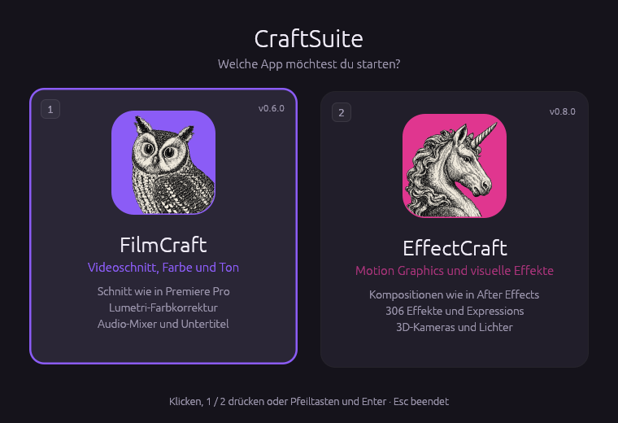

<p align="center">
  
</p>

<h1 align="center">CraftSuite</h1>

<p align="center"><b>FilmCraft und EffectCraft in einer App.</b><br>
Ein Startfenster, zwei vollständige Programme: Videoschnitt wie in Premiere Pro und Motion Graphics wie in After Effects.</p>

<p align="center">
  
</p>

## Was ist das?

Beim Start von CraftSuite erscheint ein Auswahlfenster mit beiden Apps. Ein Klick (oder die Taste
`1` bzw. `2`) startet die gewählte App, das Startfenster schließt sich.

| App | Wofür | Version |
|---|---|---|
| **FilmCraft** | Videoschnitt, Farbkorrektur und Ton, aufgebaut wie Adobe Premiere Pro | 0.6.0 |
| **EffectCraft** | Motion Graphics und visuelle Effekte, aufgebaut wie Adobe After Effects | 0.8.0 |

Beide Apps sind die Originale, aus ihrem Quellcode gebaut, mit allen ihren Funktionen eins zu eins,
einschließlich der Kommandozeilen-Tools und MCP-Server. CraftSuite ergänzt nur kleine Verbesserungen,
die als Patch-Dateien in `patches/` liegen und beim Bauen angewendet werden:

| Patch | Was er ändert |
|---|---|
| `patches/filmcraft/0001-…` | Nach dem Export erscheint „Export abgeschlossen“ mit dem Speicherort und „Im Ordner zeigen“ (vorher gab es nur einen kleinen Fortschrittsbalken, der wortlos verschwand). Standard-Speicherort unter Windows ist der Videos-Ordner statt des Benutzerordners. |

## Installieren (Windows)

1. Unter [Releases](../../releases) (oder im letzten Lauf unter [Actions](../../actions) bei
   „Artifacts“) **`CraftSuite-Setup-….exe`** herunterladen.
2. Doppelklicken und durchklicken. CraftSuite wird **nur für deinen Benutzer** installiert
   (`%LOCALAPPDATA%\Programs\CraftSuite`): **kein Admin-Passwort, keine PIN**. Danach steht es im
   Startmenü (auf Wunsch auch auf dem Desktop), und `.fcproj`-/`.ecproj`-Dateien öffnen sich per
   Doppelklick in der richtigen App.
3. Bei der Windows-Warnung „Weitere Informationen“ und dann „Trotzdem ausführen“ wählen (die Dateien
   sind nicht digital signiert).

Alternativ gibt es eine **Portable-Version** zum Entpacken und Starten, ganz ohne Installation.

## Bedienung

- **Maus:** auf eine der beiden Karten klicken.
- **Tastatur:** `1` = FilmCraft, `2` = EffectCraft, oder Pfeiltasten und `Enter`. `Esc` schließt.
- **Projektdatei:** Eine Datei auf `CraftSuite.exe` ziehen oder damit öffnen. `.fcproj` startet
  FilmCraft, `.ecproj` / `.ecprojx` startet EffectCraft, ohne Startfenster.
- **Kommandozeile:** `CraftSuite --filmcraft …` oder `CraftSuite --effectcraft …`. Alle weiteren
  Argumente gehen unverändert an die App.

## Aufbau

```
CraftSuite/
├── CraftSuite.exe          das Startfenster
├── FilmCraft/
│   ├── filmcraft.exe       FilmCraft (Original)
│   └── filmcraft-cli.exe   Kommandozeile und MCP-Server
└── EffectCraft/
    ├── effectcraft.exe     EffectCraft (Original)
    └── effectcraft-cli.exe Kommandozeile und MCP-Server
```

Im Repository:

| Pfad | Inhalt |
|---|---|
| `src/main.rs` | das Startfenster (Rust, egui) |
| `vendor/filmcraft` | FilmCraft als Git-Submodul, festgelegt auf `v0.6.0` |
| `vendor/effectcraft` | EffectCraft als Git-Submodul, festgelegt auf `v0.8.0` |
| `patches/` | kleine Verbesserungen an den Apps, beim Bauen angewendet |
| `installer/CraftSuite.iss` | der Installer (Inno Setup, pro Benutzer, ohne Admin) |
| `packaging/assemble.sh` | baut den fertigen Ordner aus den drei Programmen zusammen |
| `.github/workflows/windows.yml` | baut alles für Windows und erstellt das ZIP |

Jede App wird in ihrem eigenen Workspace mit ihrer eigenen `Cargo.lock` gebaut, genau wie bei ihren
offiziellen Releases. So verhalten sie sich exakt wie die Originale.

## Selbst bauen

Benötigt [Rust](https://rustup.rs/) 1.95 oder neuer.

```sh
git clone --recurse-submodules https://github.com/<du>/CraftSuite
cd CraftSuite
(cd vendor/filmcraft   && cargo build --release --locked -p filmcraft   -p filmcraft-cli)
(cd vendor/effectcraft && cargo build --release --locked -p effectcraft -p effectcraft-cli)
cargo build --release --locked
packaging/assemble.sh dist/CraftSuite target/release/craftsuite \
  vendor/filmcraft/target/release vendor/effectcraft/target/release   # unter Windows: … .exe
```

Zum Entwickeln am Startfenster lassen sich die Apps auch über Umgebungsvariablen angeben:
`CRAFTSUITE_FILMCRAFT=/pfad/zu/filmcraft` und `CRAFTSUITE_EFFECTCRAFT=/pfad/zu/effectcraft`.

## Neue Versionen der Apps übernehmen

```sh
cd vendor/filmcraft   && git fetch --depth 1 origin tag v0.7.0 && git checkout v0.7.0 && cd ../..
cd vendor/effectcraft && git fetch --depth 1 origin tag v0.9.0 && git checkout v0.9.0 && cd ../..
git commit -am "FilmCraft 0.7.0, EffectCraft 0.9.0"
```

Die Versionsnummern im Startfenster werden beim Bauen automatisch aus den Submodulen gelesen.
Ein Tag wie `v0.2.0` erstellt über GitHub Actions ein Release mit dem fertigen ZIP.

## Lizenz und Herkunft

[FilmCraft](https://github.com/storytold/filmcraft) und [EffectCraft](https://github.com/storytold/effectcraft)
stammen vom ArtCraft-Team und den Mitwirkenden der Projekte und stehen unter MIT OR Apache-2.0.
Ihre Lizenztexte und Hinweise liegen im fertigen Paket in den Ordnern `FilmCraft/` und `EffectCraft/`.
Die App-Icons sind Teil dieser Projekte und stehen unter derselben Lizenz.

Das Startfenster (dieses Repository ohne `vendor/`) steht ebenfalls unter
[MIT](LICENSE-MIT) OR [Apache-2.0](LICENSE-APACHE).

CraftSuite ist ein unabhängiges Projekt und nicht mit ArtCraft verbunden. Adobe, Premiere Pro und
After Effects sind Marken von Adobe Inc.; CraftSuite steht in keiner Verbindung zu Adobe.
